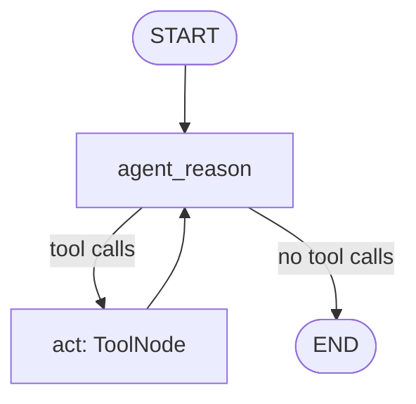

# First LangGraph: nodes, state, edges, and tool execution

Branch: `langgraph` · Code dates: October 22, 2026.

**Come back here for:** First `StateGraph`, `MessagesState`, `ToolNode`, conditional edge, and compiled graph invocation.

## What changed

Compared with the handwritten agent loop, routing and message accumulation are now managed by an explicit LangGraph.

## Code and flow

- [main.py](main.py): creates the graph and formats a city input with `HumanMessagePromptTemplate`; invokes it with `{"messages": [question]}`.
- [nodes.py](nodes.py): prepends a fixed `SystemMessage` to accumulated state and invokes the tool-bound model; `ToolNode` executes requested calls.
- [react.py](react.py): binds `get_weather` and `triple`. Weather uses the OpenWeather API, parses JSON, and requests Fahrenheit. Tavily is commented out of the tool list.



Checked-in render: [flow.png](flow.png). `main.py` renders it with Mermaid when imported/run. Slow or unsuccessful tools can prolong the loop; there is no explicit application retry budget. Prompt templates format messages; they do not sanitize user instructions.

## Run

Run from the repository root with Python 3.14+. Dependencies follow this branch's `pyproject.toml`; `--no-install-project` avoids building the exercise's package scaffold.

```bash
uv sync --no-install-project
uv run --no-sync python main.py
```

Local `.env`: `OPENAI_API_KEY` and `WEATHER_API_KEY` for OpenWeather. Diagram rendering may require network access.

## Place in the practice sequence

Previous topic: [doc-assistant](https://github.com/Sud-m/langchain-and-langgraph/tree/doc-assistant) · Next topic: [reflection-agent](https://github.com/Sud-m/langchain-and-langgraph/tree/reflection-agent) · [Full learning timeline](https://github.com/Sud-m/langchain-and-langgraph/blob/mcp-practice/README.md)

Dates reflect code commits before this README update, not branch creation times. Comparisons follow the learning sequence, not necessarily Git ancestry. Practice based on Eden Marco's LangChain/LangGraph course.
