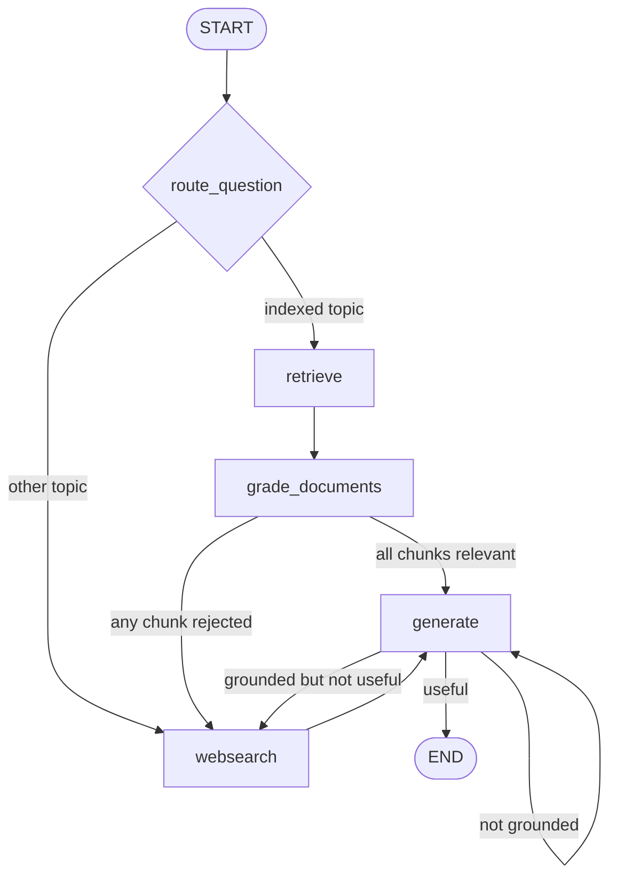

# Adaptive RAG: route the question before retrieval

Branch: `adaptive-rag` · Code dates: October 27, 2026.

**Come back here for:** First conditional entry point and structured router choosing vector retrieval versus web search.

## What changed

Compared with self-rag, the graph chooses its initial data source by topic instead of always retrieving from Pinecone first.

## Code and flow

- [graph/chains/router.py](graph/chains/router.py): `RouteQuery.datasource` is `Literal["vectorstore", "websearch"]`. Agent, prompting, and adversarial-attack questions go to the indexed articles; other topics go straight to Tavily.
- [graph/graph.py](graph/graph.py): uses only the conditional entry point, keeps relevance/grounding/usefulness checks, and removes the unconditional generate-to-END edge.
- [graph/nodes/web_search.py](graph/nodes/web_search.py): uses `state.get("documents")` because direct web entry has no retrieved documents yet.
- [main.py](main.py): the sample asks about agent memory plus the later MemoryGraft paper to exercise indexed concepts and potentially web evidence.



Checked-in render: [graph.png](graph.png). `web_search` means search is needed, not search was used; it can be absent on direct web routes. State type hints do not populate missing keys. Relevance does not guarantee complete evidence, and no explicit retry budget exists. The grounding-failure log mentions web search, but its actual route regenerates from the same documents. Ingestion still runs on import; vector upload is commented out.

## Run

Run from the repository root with Python 3.14+. Dependencies follow this branch's `pyproject.toml`; `--no-install-project` avoids building the exercise's package scaffold.

```bash
uv sync --no-install-project
uv run --no-sync python main.py
uv run --no-sync python -m graph.nodes.web_search
```

Local `.env`: `OPENAI_API_KEY`, `PINECONE_API_KEY`, `INDEX_NAME`, and `TAVILY_API_KEY`; a populated index. Diagram rendering may require network access.

## Place in the practice sequence

Previous topic: [self-rag](https://github.com/Sud-m/langchain/tree/self-rag) · [Full learning timeline](https://github.com/Sud-m/langchain/blob/mcp-practice/README.md)

Dates reflect code commits before this README update, not branch creation times. Comparisons follow the learning sequence, not necessarily Git ancestry. Practice based on Eden Marco's LangChain/LangGraph course.
