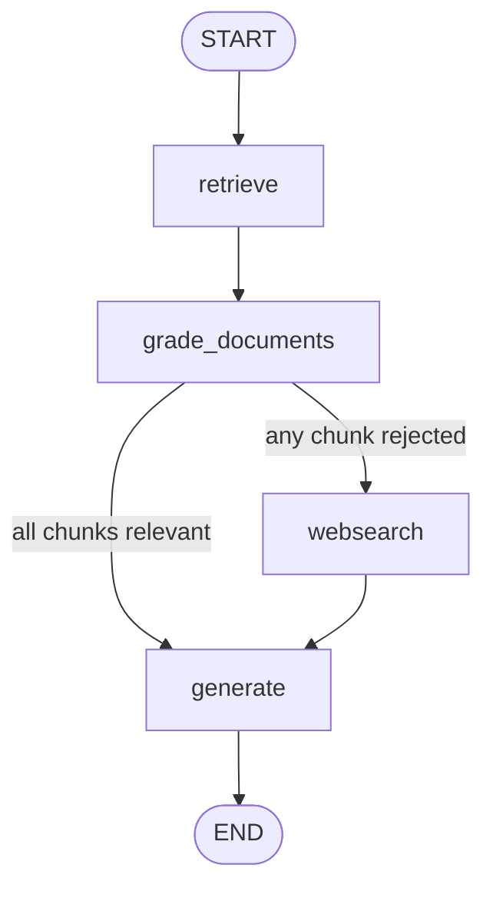

# Corrective RAG: grade retrieval and supplement with search

Branch: `agent-rag` · Code dates: October 26, 2026 (11:46).

**Come back here for:** First modular `graph/chains` / `graph/nodes` layout, document-relevance grader, and web-search fallback.

## What changed

Returns to RAG after the reflection exercises. Compared with rag-first, retrieved chunks are graded and irrelevant results trigger corrective web research before answering.

## Code and flow

- [ingestion.py](ingestion.py): loads three Lilian Weng articles (prompt engineering, agents, adversarial attacks), flattens `docs` into `doc_list`, and splits with a 250-token target / zero overlap. Retrieves `k=3` from Pinecone.
- [graph/state.py](graph/state.py) holds question, documents, generation, and a `web_search` flag meaning search is needed.
- [graph/nodes/grade_documents.py](graph/nodes/grade_documents.py) grades each chunk, keeps relevant ones, and flags web search if any are rejected. [web_search.py](graph/nodes/web_search.py) combines Tavily results into one additional `Document`.
- [graph/chains/retrieval_grader.py](graph/chains/retrieval_grader.py) uses structured output; [test_chains.py](graph/chains/tests/test_chains.py) exercises live retrieval/grading.



Checked-in render: [graph.png](graph.png). This is a single-pass corrective flow, not a post-generation validation loop. `ingestion.py` fetches/splits pages on import; the Pinecone upload block is commented out, so an already populated index is required. Retrieved chunk rank does not guarantee relevance.

## Run

Run from the repository root with Python 3.14+. Dependencies follow this branch's `pyproject.toml`; `--no-install-project` avoids building the exercise's package scaffold.

```bash
uv sync --no-install-project
uv run --no-sync python main.py
uv run --no-sync python -m graph.nodes.web_search
```

Local `.env`: `OPENAI_API_KEY`, `PINECONE_API_KEY`, `INDEX_NAME`, and `TAVILY_API_KEY`; a populated index with matching embeddings.

## Place in the practice sequence

Previous topic: [reflexion-agent](https://github.com/Sud-m/langchain/tree/reflexion-agent) · Next topic: [self-rag](https://github.com/Sud-m/langchain/tree/self-rag) · [Full learning timeline](https://github.com/Sud-m/langchain/blob/mcp-practice/README.md)

Dates reflect code commits before this README update, not branch creation times. Comparisons follow the learning sequence, not necessarily Git ancestry. Practice based on Eden Marco's LangChain/LangGraph course.
