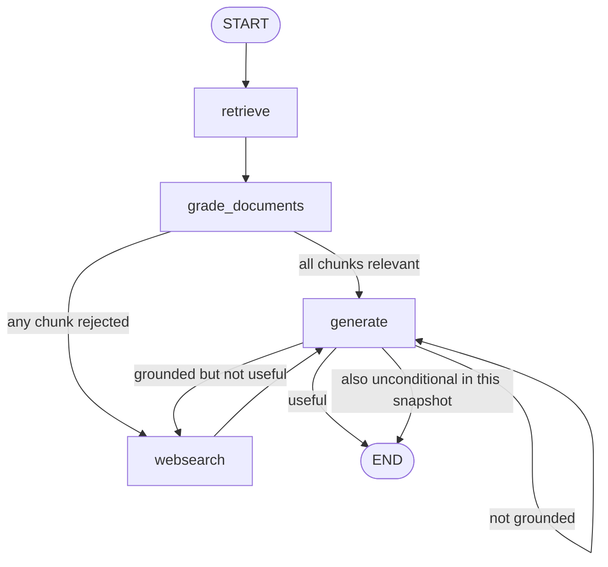

# Self-RAG: grade the generated answer and retry

Branch: `self-rag` · Code dates: October 26, 2026 (12:02–13:25).

**Come back here for:** First post-generation grounding grader, answer-usefulness grader, and conditional regeneration loop.

## What changed

Compared with agent-rag, retrieval quality is no longer the only check: the generated answer is assessed against both documents and the question.

## Code and flow

- Retains the corrective retrieval, chunk grading, and Tavily fallback from agent-rag.
- [graph/chains/hallucination_grader.py](graph/chains/hallucination_grader.py) checks support in the supplied documents. [answer_grader.py](graph/chains/answer_grader.py) checks whether the answer addresses the question.
- [graph/graph.py](graph/graph.py) maps unsupported answers back to generation, supported-but-unhelpful answers to web search, and useful answers to `END`.



Checked-in render: [graph.png](graph.png). Important snapshot quirk: `flow.add_edge(GENERATE, END)` remains alongside conditional routing; it is not a fallback and should be removed when relying on the grader. The adaptive-rag branch contains that correction. No explicit retry budget is implemented. Graders provide model judgments, not guarantees of truth. Ingestion still runs on import and its vector upload is commented out.

## Run

Run from the repository root with Python 3.14+. Dependencies follow this branch's `pyproject.toml`; `--no-install-project` avoids building the exercise's package scaffold.

```bash
uv sync --no-install-project
uv run --no-sync python main.py
```

Local `.env`: `OPENAI_API_KEY`, `PINECONE_API_KEY`, `INDEX_NAME`, and `TAVILY_API_KEY`; a populated index. Diagram rendering may require network access.

## Place in the practice sequence

Previous topic: [agent-rag](https://github.com/Sud-m/langchain-and-langgraph/tree/agent-rag) · Next topic: [adaptive-rag](https://github.com/Sud-m/langchain-and-langgraph/tree/adaptive-rag) · [Full learning timeline](https://github.com/Sud-m/langchain-and-langgraph/blob/mcp-practice/README.md)

Dates reflect code commits before this README update, not branch creation times. Comparisons follow the learning sequence, not necessarily Git ancestry. Practice based on Eden Marco's LangChain/LangGraph course.
