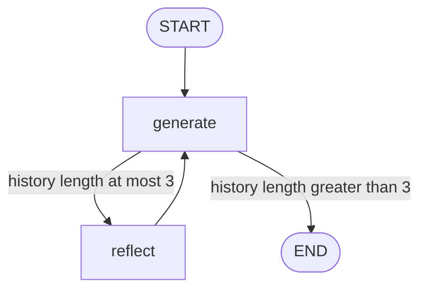

# Reflection: generate, critique, and rewrite a tweet

Branch: `reflection-agent` · Code dates: October 23, 2026 (morning).

**Come back here for:** First model-generated critique loop, `MessagesPlaceholder`, and explicit `Annotated[..., add_messages]` state.

## What changed

Compared with the tool-executing graph, improvement comes from a second LLM role. There is no web search or external research.

## Code and flow

- [chains.py](chains.py): separate generation and reflection prompts share `gpt-4o-mini`; each prompt prepends its own system instruction to the same history.
- [main.py](main.py): generation returns an `AIMessage`; reflection converts the critic response into a `HumanMessage` so the writer sees editorial feedback.
- State uses `add_messages` to accumulate request, drafts, and critiques. With one initial request, `len(messages) > 3` stops after two drafts and one critique.



Checked-in render: [graph.png](graph.png). The generator requests only tweet text; the critic prioritizes virality/style, so fidelity to the original complaint is still worth checking. A critique is model feedback, not independent evidence.

## Run

Run from the repository root with Python 3.14+. Dependencies follow this branch's `pyproject.toml`; `--no-install-project` avoids building the exercise's package scaffold.

```bash
uv sync --no-install-project
uv run --no-sync python main.py
```

Local `.env`: `OPENAI_API_KEY`. Diagram rendering may require network access.

## Place in the practice sequence

Previous topic: [langgraph](https://github.com/Sud-m/langchain-and-langgraph/tree/langgraph) · Next topic: [reflexion-agent](https://github.com/Sud-m/langchain-and-langgraph/tree/reflexion-agent) · [Full learning timeline](https://github.com/Sud-m/langchain-and-langgraph/blob/mcp-practice/README.md)

Dates reflect code commits before this README update, not branch creation times. Comparisons follow the learning sequence, not necessarily Git ancestry. Practice based on Eden Marco's LangChain/LangGraph course.
