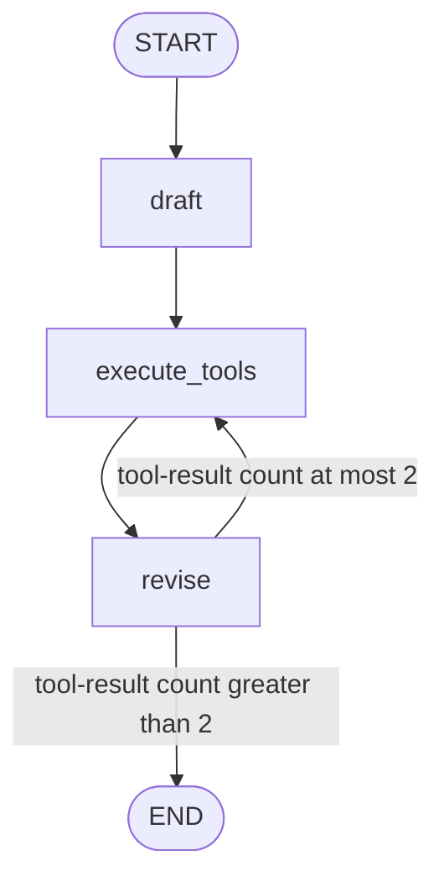

# Reflexion: critique, research, and revise

Branch: `reflexion-agent` · Code dates: October 23, 2026 (afternoon/evening).

**Come back here for:** First schema-shaped research loop, `.partial()` prompts, and `StructuredTool.from_function` dispatch.

## What changed

Compared with reflection-agent, critiques generate search queries and Tavily supplies external evidence before revision.

## Code and flow

- [schemas.py](schemas.py): `AnswerQuestion` contains answer, reflection, and search queries; `ReviseAnswer` adds references. Descriptions guide the model; word counts are not enforced automatically.
- [chains.py](chains.py): first-responder/revisor prompts force the corresponding tool-call format. `parser` is unused; `parser_pydantic` is only used by the standalone example, not graph execution.
- [tool_executor.py](tool_executor.py): registers both tool names to the same `run_queries` function. It extracts `search_queries` and batches Tavily searches; the LLM chains, not this function, write/revise answers.
- [main.py](main.py): keeps raw `AIMessage` tool calls in state and prints the final call's `args["answer"]` rather than empty `.content`.



Checked-in render: [graph.png](graph.png). `MAX_ITERATIONS=2` is compared with `>` against `ToolMessage` count: with one call per turn, this permits three research batches. Final proposed searches remain unexecuted after termination. The graph does not explicitly validate `ReviseAnswer` with Pydantic, so missing references can pass through.

## Run

Run from the repository root with Python 3.14+. Dependencies follow this branch's `pyproject.toml`; `--no-install-project` avoids building the exercise's package scaffold.

```bash
uv sync --no-install-project
uv run --no-sync python main.py
```

Local `.env`: `OPENAI_API_KEY` and `TAVILY_API_KEY`. Diagram rendering may require network access.

## Place in the practice sequence

Previous topic: [reflection-agent](https://github.com/Sud-m/langchain/tree/reflection-agent) · Next topic: [agent-rag](https://github.com/Sud-m/langchain/tree/agent-rag) · [Full learning timeline](https://github.com/Sud-m/langchain/blob/mcp-practice/README.md)

Dates reflect code commits before this README update, not branch creation times. Comparisons follow the learning sequence, not necessarily Git ancestry. Practice based on Eden Marco's LangChain/LangGraph course.
